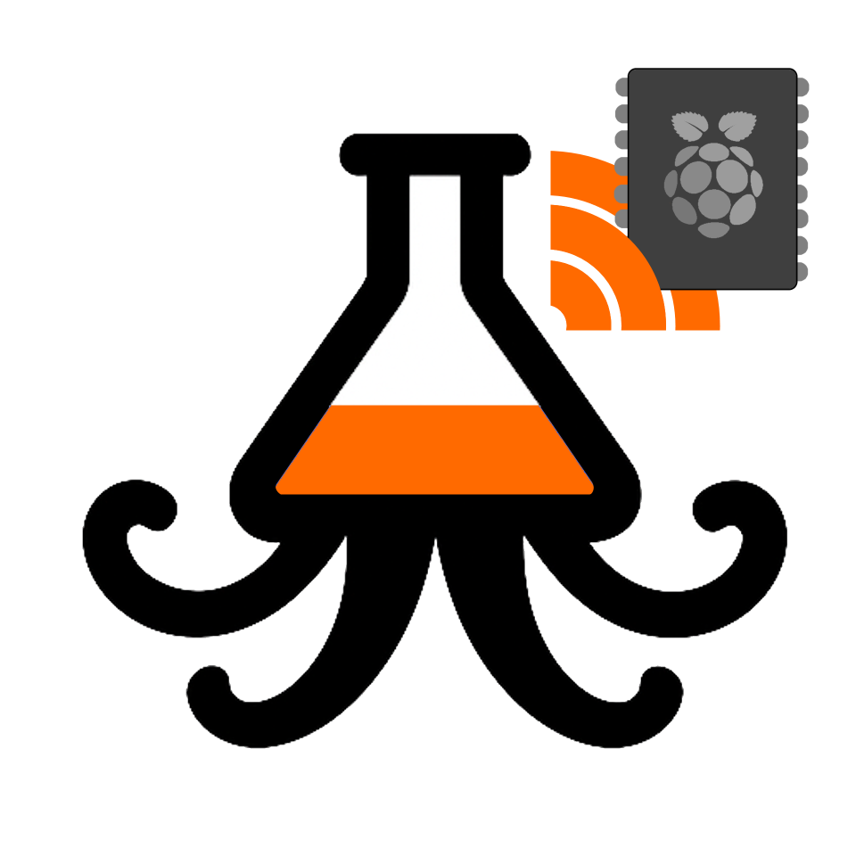
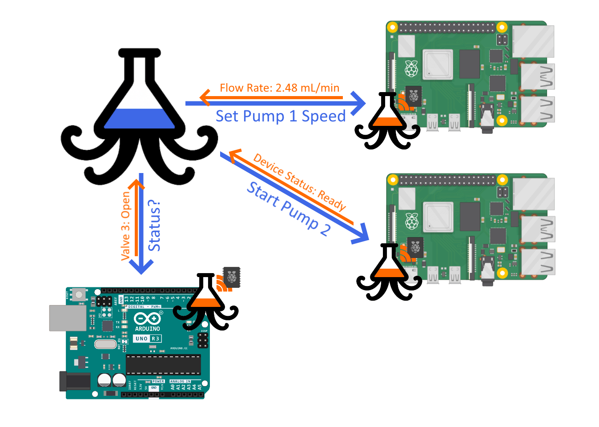

# Optipus Peripherals

<p align="center">
  <a href="https://optipus.net">
    
  </a>
</p>

Open-source client skeletons for connecting Raspberry Pi, ESP32, and
Arduino-compatible devices to an Optipus Data Server.

Optipus Peripherals is a starting point for building your own sensors,
laboratory devices, controllers, and actuators. Use the examples as a
foundation for your device logic, then adapt the hardware integration,
read/write nodes, timing, and safety behavior to your application.

Learn more about Optipus at [optipus.net](https://optipus.net).

## How it works

An Optipus Peripheral communicates with an Optipus Data Server:

- Optipus writes setpoints, commands, or configuration values to the device.
- The device reads those values and applies its own hardware logic.
- The device writes measurements, state, and health information back to
  Optipus.
- Optipus can then store, sample, visualize, and use those values in process
  monitoring, watchdogs, and automated experiments.



## Repository contents

```text
python/                         Python client library
examples/raspberry_pi.py        Raspberry Pi example
examples/esp32_main.cpp         ESP32 example
examples/arduino_basic.ino      Arduino example
arduino/OptipusPeripheral/      Arduino-compatible client library
images/                         Project and protocol illustrations
```

## Quick start: Raspberry Pi

The Python example uses only the Python standard library.

1. Start an Optipus Data Server or Optipus Peripheral Process.
2. Open `examples/raspberry_pi.py`.
3. Configure the Optipus host, port, peripheral name, and intervals.
4. From the repository root, run:

   ```bash
   python -m examples.raspberry_pi
   ```

The example demonstrates reading a setpoint and writing a measured
temperature. Replace the example measurement with your GPIO, I2C, SPI, serial,
or other hardware integration.

## Configuration

The client accepts:

- Optipus host and port
- Peripheral identifier and display name
- Request interval
- Heartbeat interval
- HTTP timeout

The peripheral identifier identifies the client configuration. Each dedicated
Optipus Peripheral Process has its own server tree, so values are written
directly below the `peripheral` node:

```text
peripheral.meta.name
peripheral.meta.platform
peripheral.meta.protocolVersion

peripheral.status.online
peripheral.status.enabled
peripheral.status.lastRequestTimestamp
peripheral.status.lastSuccessTimestamp
peripheral.status.lastError
peripheral.status.errorFlag
peripheral.status.requestCount

peripheral.values.<your-node>
```

User-defined values belong below `peripheral.values`. Keep application data
separate from the reserved `meta` and `status` nodes.

Use `setErrorCode(code)` to publish a positive integer application error code
and `resetError()` to clear it:

```python
peripheral.setErrorCode(12)
peripheral.resetError()
```

The client also publishes error code `1` when a request fails at the transport
level. Define and document device-specific error codes in your own project.

## Current compatibility API

The client skeleton currently supports the legacy Data Server endpoints:

```text
GET /list/<path>
GET /set/<path>/<value>
```

Values are scalar in this compatibility version. The endpoint uses URL paths
for writes and is intended for trusted development or local-network
deployments. Do not expose an unauthenticated Data Server directly to the
public internet.

## Supported platforms

### Raspberry Pi

Use the Python client with Linux hardware libraries such as GPIO, I2C, SPI,
serial, or vendor-specific SDKs.

### ESP32

Use the Arduino framework example in `examples/esp32_main.cpp` and provide a
Wi-Fi client implementation.

### Arduino-compatible boards

Use the library in `arduino/OptipusPeripheral/` with an Ethernet, Wi-Fi, or
other Arduino-compatible `Client` implementation.

## Safety and responsibility

This project is a supported companion repository, but it is not part of the Optipus application and is not a finished device integration. It is not certified, safety-rated, or intended to replace professional engineering functional-safety, or regulatory assessment.

The software and examples are provided **as is** and **as available**, without warranties of any kind. Optipus Peripherals and the contributors do not guarantee that the software is accurate, secure, uninterrupted, error-free, or suitable for a particular purpose. Optipus Peripherals and the contributors are not responsible for device construction,
wiring, configuration, network security, hardware selection, or the results of applying this software to a user's system.

You are responsible for evaluating, adapting, testing, and safely operating your complete system. Before deployment, add suitable input validation, timeouts, output limits, watchdogs, emergency stops, isolation, redundancy, and fail-safe behavior as appropriate for the application. Test failure modes, loss of communication, invalid values, power loss, and unexpected restarts.

Do not use this repository or an unmodified example in systems involving people's safety, medical care, hazardous energy, fire protection, vehicles, chemical processes, or other safety-critical, regulated, or high-consequence applications. Do not rely on this software as the sole protection against damage, injury, or loss.


## Project status

This repository is an evolving open-source starting point. The current client uses the legacy Data Server compatibility API; a versioned JSON API, authentication options, broader automated tests, and additional platform examples can be added as the project develops.

## Related links

- [Optipus website](https://optipus.net)
- [Optipus Peripherals on GitHub](https://github.com/SKenb/optipus-peripherals)
